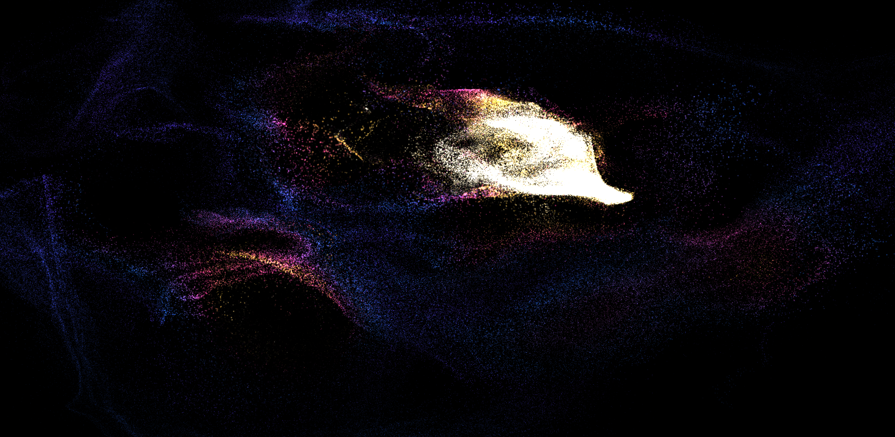
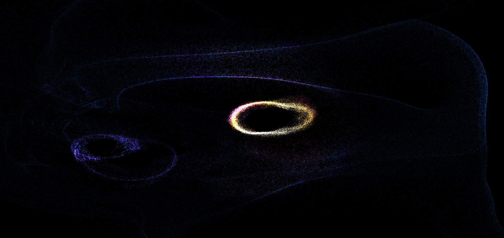
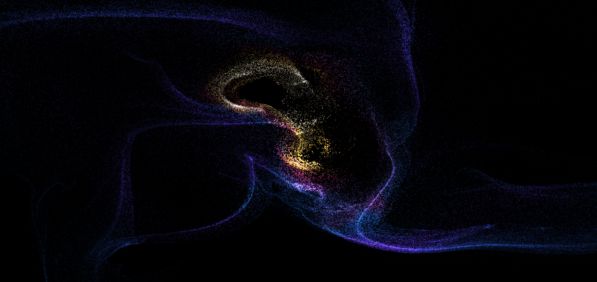
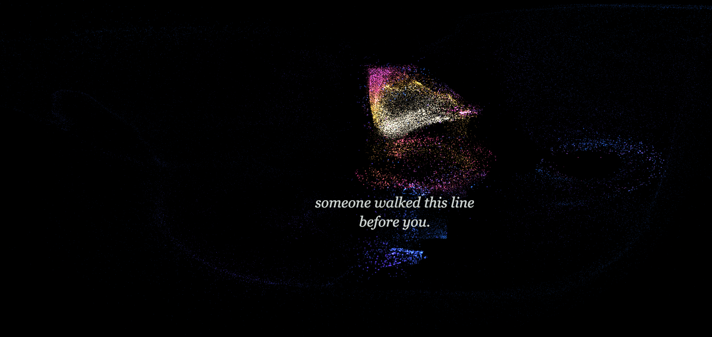

# THE ROOM REMEMBERS YOU

An offline, privacy-preserving interactive installation for a white-box gallery. Camera frames are reduced immediately to anonymous motion blobs; no video frame is ever retained, written, or transmitted.

Sound is treated differently, and the difference matters. So that the room can return a visitor's own voice to them later in the same visit, short recordings of actual speech are held **in memory, during the session only**, bounded to 80 clips and 32 MiB. They are erased on reload, on microphone shutdown, and on reset, and they are never written to disk — only a transformed amplitude envelope and spectral brightness can persist. In strict privacy mode, even those envelopes stay session-only and no recording is kept at all. Nothing leaves the installation computer in any mode: there is no network call, no cloud service, and no account.

The room is dark and a field of up to 360,000 particles is the only light in it. The swarm runs on the room's own memory: where people have walked becomes current, and the particles follow it. A living body is a bright vortex the field gathers around, cooling to violet and deep blue as the room forgets. Each of the six ways the room can recall something arrives in its own colour.



A single body, stirring. The hot ring is where someone is now; the cooler one is where they were a few seconds ago.



An empty room. Nobody is present and the camera sees no motion — the vortex crossing the space is a memory the room is replaying, rendered exactly as a living visitor would be.



Rarely, the room says one thing about what it just noticed, placed beside whoever caused it.



## Run the installation

```sh
npm install
npm run exhibit -- --kiosk
```

Without kiosk mode, run `npm run exhibit` and open `http://127.0.0.1:3000/`. The browser will request camera and microphone access after **Enter the room** is selected. Press **O** for the hidden operator console, **D** for the sensing instrument, **T** for the tracking overlay, and **F** for fullscreen.

To start the installation automatically after macOS login, run `npm run install-autostart` once. This deliberately is not installed without operator action because it creates a per-user LaunchAgent. Automatic camera/microphone access still depends on permissions previously granted to Chrome.

The production launcher builds once, starts the local server, and watches the room itself. The page reports a pulse — frame rate, sensing rate, person count — every five seconds, and the launcher relaunches the browser if that stops, or if the page is still reporting while no longer drawing frames. A frozen render loop is the failure that matters here: a crashed tab at least shows an error page, while a stalled one keeps showing its last frame, which on a dark gallery wall is indistinguishable from a room with nothing to remember. A lost GPU context is recovered from in place, and a render error rebuilds the room without restarting anything. All sensing, rendering, sound transformation, and persistence stay on the installation computer; no cloud connection is used.

## Operator setup

1. Check the **Hardware profile**. It is detected from the machine on first run — Apple silicon and discrete GPUs get FULL (360,000 particles, 24 Hz sensing), integrated graphics get STANDARD, anything without WebGL2 float targets gets CHEAP. Your saved choice always wins over detection. If sensing is running below about 12 Hz the instrument will say so: at that rate movement has to persist over 200 ms to register at all.
2. Choose the **Visual engine**. *Particle field* is the default and needs WebGL2 with `EXT_color_buffer_float`; the operator console reports the particle count when it starts, or why it could not. *Line traces* is the fallback when GPU rendering is unavailable.
3. Choose the **Projection surface**. *Dark room* is the default: the projector paints black and emits light only where the room remembers something, so the projector's own rectangle disappears from the wall, the space stays dark, and the camera has very little of the artwork's light to reject. Choose *Lit surface* for an LCD panel, a bright scrim, or a room that cannot be darkened; marks are then drawn as ink into a bright field. Both are held to the same measured contrast floors.
4. Aim the camera so people contrast with a mostly static background. **Mount it high and look across the room**, not at desk range — this is the geometry every detection default assumes, and it is what lets two visitors standing apart read as two people rather than one shape. Keep the projected surface out of the camera frame where possible: otherwise the artwork's own changing image becomes sensor input. Camera analysis stays at 160×90 while projection renders at the display refresh rate. Choose CHEAP (10 FPS/4 tracks), STANDARD (15 FPS/8 tracks), or FULL (24 FPS/12 tracks) according to the installation computer.

   How large a body is in the frame is measured from the scene rather than assumed, because it depends entirely on where the camera is: a visitor covers a few hundred grid cells at desk range and about seven across a gallery. Press **D** and read **Body scale** to see the figure in force. It takes a few seconds of somebody moving to establish, and until it does the room does not apply its plausibility bound at all. Use **Relearn empty room** after moving the camera; the scale is discarded with the background, because both belong to the old aim.
5. Press **O** and inspect **Live motion diagnostics**. With an empty room, accepted cells and live tracks should settle at zero. Faint cells are one-frame candidates; white cells are accepted motion. If they do not settle, increase movement sensitivity. Use **Relearn empty room** after moving the camera or changing room lighting, then keep the room empty for about one second.
6. Select **Begin spatial calibration**. Stand on each of the four projected markers and press **Space**. The resulting four point pairs solve a projective camera-to-projector homography, so sensed positions and projected traces share room coordinates. Crop, rotation, and keystone controls correct the final projector surface.
7. Set the whisper threshold just above the empty room's noise floor. Real voice recordings remain in RAM only, bounded to 80 clips and 32 MiB; reload, microphone shutdown, or reset erases them. Only transformed envelopes can persist. In strict privacy mode, those envelopes also remain session-only; outside strict mode they may persist until the configured automatic expiration.
8. Place the **speakers**. Two powered speakers separated across the space, not a television's built-in pair: remembered voices and the room's own lines are panned to where the room associates them, and on a single enclosure three metres away every one of them arrives from the same point. With real separation a visitor can hear their own earlier voice come back from approximately where they said it, which is the strongest thing the sound does. The room holds the microphone closed while it speaks or replays, so it cannot record itself; browser echo cancellation stays on as well.
9. Choose **Open gallery day** for the opening ritual. The room reduces yesterday to a faint residue and wakes over 20 seconds. At closing, choose **Close gallery day**; the day resurfaces for 90 seconds, then compresses into long-term memory.
10. Close the console and press **F**. Leave the threshold screen visible so visitors receive the local-processing notice and the browser receives a user gesture for audio.

If a camera is unavailable, enable **Demo motion** and move the pointer to validate trails. Camera, microphone, tracking, persistence, and sound failures are isolated so the remaining installation continues.

## When the room is not seeing anybody

Press **T** first. It draws a hard green reticle on every tracked person, straight onto the wall, with a live/hidden/candidate label and their coordinates. Walk about and watch whether it follows you. The artwork's own response is deliberately atmospheric, which makes it hard to tell alone whether the room has you at all; this is the opposite, and it is not subtle on purpose.

Press **D** for the sensing instrument. It is the only way to tell a broken camera from an empty gallery: both render the same beautiful empty field.

It walks the pipeline in order — camera → frames → changed pixels → cells → bodies → tracks — highlights the first stage that has stalled, and says what to do about it. It also draws the live 40×23 motion grid (dim cells are one-frame candidates, bright cells are accepted motion, circles are tracks) and, separately, where those tracks land on the wall after mirroring and calibration. Detected in the wrong place and not detected at all look identical from the front of the room; these two panels tell them apart.

The failure most likely to catch you first is **scene-change rejection**. Frames in which more than `sceneChangeCoverage` of the 40×23 grid is active — 85% by default — are discarded as a lighting change, as are frames where more than 92% of pixels differ. The guard tests *spatial coverage* rather than changed pixels, because the two are not the same: one person close to the camera changes a large share of the pixels while occupying only part of the room, and an earlier pixel-fraction version of this guard rejected a fifth of all frames on a real desk-range session. A genuine lighting change lights up essentially every cell. The instrument names this explicitly and prints both numbers. Raise the limit, or move the camera back.

To diagnose something intermittent, export the sensing log from the instrument and read it back:

```sh
npm run analyze-session -- sensing-log-….json
```

It reports the loop rate, how often the scene-change guard fired, how stable the population was, and what was blocking across the whole session. Churn above about 35% means detections are fragmenting or association is failing. The log holds aggregate counts only — no coordinates and no imagery — which is why it records continuously.

A camera mounted high and looking across the room tracks far better than a laptop webcam. Pick between connected cameras under **Camera** in the operator console; the list populates once camera access has been granted. Choosing a device pins it exactly rather than falling back to the built-in camera, because a plausible-looking picture from the wrong lens is worse than an error.

Emergency keys work without opening the console: **T** shows the tracking overlay, **D** opens the sensing instrument, **B** toggles blackout, **M** toggles mute, and **Alt+Shift+R** resets all room memory. Reset has a confirmation inside the operator console; the emergency chord is intentionally immediate.

## Simulation and reproducible debugging

The operator console can run synthetic gallery traffic at 60× or 720× real time, including walking, clustering, stillness, and crossing patterns. Enable anonymous event recording to retain a one-hour ring buffer sampled once per second. The JSON export contains only ephemeral IDs, coordinates, velocity, speed, and occlusion state. It can be imported and replayed from the same console.

The live diagnostic mask is an in-memory 40×23 grid of changed cells, not video, and is never persisted. Its input label exposes accidental demo, simulation, or replay sources. Uniform brightness changes are compensated, room-wide scene changes are rejected, and local movement must persist across two analysis frames before it can create a blob. Tracks retained only for occlusion recovery are reported as hidden and are not drawn or deposited into memory.

`npm run burn-in` executes a deterministic 12-hour virtual gallery day and writes [reports/burn-in-latest.json](reports/burn-in-latest.json). The gate fails if memory fields leave their numerical bound, ghosts/whispers/event logs exceed their caps, serialized state exceeds 2 MiB, retained heap grows by more than 16 MB against a measured 5.8 MB, a disturbed memory occupies more than 10% of gallery time, or the room's interest in a visitor who never leaves could exceed 15% of the day. It runs under `--expose-gc` and collects on both sides of the heap sample; figures recorded before that change are not comparable with ones after it.

## What the room looks and sounds like

- **The particle field** (`swarm`) is the default engine: a WebGL2 GPGPU simulation, dependency-free, 65k particles on CHEAP through 262k on FULL, at 60 fps. Colour maps how alive a place is — deep indigo for ground the room barely remembers, climbing through blue and violet and pink to a hot core where somebody is standing. A body repels particles from its core and gathers them from just outside it, so a person reads as a luminous vortex rather than as a hole. Measured: local brightness rises about 49% where a body stirs the field.
- **A busy room is counted, up to twelve.** Twelve is the ceiling — it matches the FULL profile and the twelve body slots the particle shader declares — and beyond it people still stir the memory field without being tracked individually. Two limits are physical rather than chosen: visitors standing shoulder to shoulder are one silhouette to a motion detector, and so are two people the camera sees one directly behind the other. Neither is knowable from a single view, and the room does not guess.
- **The room notices what people do**, not just where they are: a wave, two people closing the distance, someone walking the line another walked moments earlier, arriving together, returning to a spot they left, two people apart moving in step. All of it from anonymous motion — no pose model, no face, no identity. Looking toward the camera and walking backwards are deliberately absent: neither is knowable without a model of where a body faces, and an approximation announced as fact would cost the visitor's belief in everything else the room says.
- **Sound memory surfaces on its own clock**, independently of anything the room is remembering visually. A whisper has to be about 25 seconds old before it can return, so it comes back as memory rather than as an echo. The threshold calibrates itself to the room — the value in the console is a floor, and the installation lifts the working threshold above whatever this space actually sounds like. Press **D** to see the measured noise floor, the threshold in force, and the live level — a silent room and a deaf one look identical from outside — and use **Play remembered whispers** in the console to hear everything currently held.
- **The room says nothing until it trusts what it is seeing.** For the first few seconds anything already standing in the room is still being learned into the background, and the artwork reacts normally while the voice stays silent. The instrument reports this as *settling* rather than as a fault.
- **The room occasionally speaks.** Rarely — at most one line a minute, and usually it stays quiet — a single sentence fades in just below whoever caused it, about something it actually detected: that you stopped, that you came back, that someone walked this line before you. It observes impersonally and says "I" only when it is unsure of itself. With **Spoken voice** on, it says the line aloud too, from a set of 34 sentences rendered offline and committed as audio, panned to the same place the text appears — so the line comes from beside its subject rather than from the speakers. The microphone is held closed for exactly as long as the line lasts, so the room cannot record itself. Where a line has no rendered file, an offline platform voice says it instead, from no particular place.
- **The room occasionally takes an interest in one person.** Rarely, and never announced: a visitor who stays, who comes back to somewhere they left, or who walks into ground an old memory lies on can accumulate enough reason for the room to attend to them for about a minute. While it does, their trace lingers a little longer than anyone else's, the memories it chooses to replay reach toward them rather than away, and its one spoken line is more likely to be about them. Then the interest fades and the room wants nobody at all for eight minutes. It is anonymous and it dies with the track: nothing is stored, nothing is carried to a later visit, and a visitor who leaves and returns is a new presence the room cannot connect to the old one. There is no display of who was chosen, in the artwork or in the operator console — a visitor should feel attended to, not be told they were. Measured over a virtual gallery day, a visitor who never leaves could hold the room's interest for at most 11.7% of it.
- **You can see your own outline.** Particles gather on the edge of the 40×23 motion grid, so a visitor sees their own shape in the field. It is an occupancy grid, never camera pixels, and never leaves memory — the room can show you yourself without ever handling your image.
- **Recalled memories walk the room as bodies.** A memory the room is replaying gets the same vortex, the same shell and the same heat as a living visitor, so alone in the room you cannot tell what is remembered from who is there. The one exception is a false memory: a spliced, fabricated path runs *cold*. It moves like a person and never warms. Nothing says so; you simply feel that something over there is not alive.
- Up to three memories may be walking at once, with slots reserved for living visitors so recalls never crowd them out.
- **Line traces** (`traces`) is the original renderer, kept as the fallback for machines without WebGL2 float render targets and can also be selected explicitly on either surface.
- Colour is the only vocabulary the piece has for its own internal states, because visitors are never given labels. Every colour is declared in [lib/palette.ts](lib/palette.ts) and held to measured floors by [lib/palette.test.ts](lib/palette.test.ts): each mark must clear ΔE 12 against its ground, and the six recall events must clear ΔE 12 against each other.
- The projection is an accumulation, not a redraw. Light deposited by a body persists in the image and decays at a rate set by the room's personality, so an overwhelmed room cannot hold a trace and a remembering room lets everything linger. A recall event is painted over the top as a travelling point of light re-walking its path.
- A false memory is magenta and breathes unevenly. Nothing announces it; it simply does not move the way the room's true recollections move.
- The room holds a continuous low tone whose level, detuning and filter follow density and personality. It sits entirely below 150 Hz while the whisper analyser starts at 180 Hz, so the installation cannot hear its own voice, and no microphone suppression is needed to keep the two apart.
- The threshold screen and the operator console follow the projection mode. In a dark room a paper-toned panel is a floodlight thrown on the gallery wall, and one more light source for the camera to reject.

## Memory behavior

- Every path and whisper has numerical strength, fidelity, recall count, lineage, and gallery-day provenance. Recall reinforces strength while lowering fidelity.
- Immediate: blurred afterimages and path residue persist for seconds.
- Short-term: crossing and dwelling reinforce a fading 64×36 room field.
- Long-term: only the field, simplified anonymous paths, event times, and transformed whisper envelopes persist in IndexedDB. Automatic expiration defaults to seven days, allowing Day 1 residue to survive into later gallery days.
- Remembering mutates the memory. Paths smooth, drift, and lose detail; whisper envelopes shorten and smear. Weak memories eventually die.
- False memories very rarely splice two unrelated paths and, when available, the contour of an older whisper. Hidden lineage preserves provenance even though the projected result is factually unreliable.
- Rare events: convergence, stillness, return, echo, false memory, and empty-room ghosts are implemented without visitor-facing labels.
- Empty room: memory continues at low activity, then forgets faster over the configured 20–60 minute period.
- Tracking predicts motion through four seconds of occlusion, retains identities during blob merges, and re-associates split bodies by predicted position and velocity.

## Validation

```sh
npm run check
```

This runs strict TypeScript checking, linting of the installation source and the UI primitives it uses, focused memory/tracking/calibration/mutation tests, the projected-colour and audio-band tests, the 12-hour burn-in, a production-runtime dependency audit, and a production build.

Colour and contrast are verified by measurement rather than by eye, but the rendered result still has to be looked at: the accumulation buffer's first version passed every numerical check and projected a white rectangle. [docs/](docs/) holds reference captures of both projection modes for comparison after a change.

### The room's voice

Every line the room can say is a fixed table of 34 sentences, so all of them are
synthesised ahead of time and committed as audio under `public/voice/`. The
gallery runtime only ever plays finished files — no model, no API key and no
network are needed to exhibit the work, and nothing was paid to anyone.

```
npm run render-voice -- --voice af_heart
```

Re-run only after changing a line. Rendering uses [Kokoro-82M](https://huggingface.co/hexgrad/Kokoro-82M)
(Apache 2.0) through `uv`, which fetches the model on first use. The voice is
`af_heart`, the only A-graded voice the model ships; the language the text is
phonemised as comes from the voice's own name, so the two cannot disagree.

Every line is rendered at one common gain rather than normalised individually,
so all 34 land at an identical level and none clips. The room's voice is
therefore quieter than the platform voice it replaces by design — set it once
with the master volume.

A line with no rendered file falls back to the platform voice, so adding one to
the table without re-rendering leaves the room able to say it. Because a
rendered file has a known length, the microphone is now closed for exactly as
long as the room speaks: the estimate it replaces overshoots by 2142 ms per line
on average, and the room spent that time unable to hear anything said to it.

### Disturbing an old memory

Crossing an archived path can awaken it beside the current visitor. Recent, faithful memories keep their route; older or repeatedly recalled ones gradually veer and dissolve before completing it. A nearby voice from this session may return with reduced clarity and fade unfinished. The room occasionally admits uncertainty as the path dissolves, subject to its normal speech cooldown.

Crossings have a four-minute room cooldown and a fifteen-minute cooldown per memory, and are checked only after the room's own behaviours have passed on a moment, so a disturbance interrupts a quiet room rather than crowding out stillness and retrace when the room is busy. Over twelve simulated hours a disturbed memory is visible about 5% of the time. Both visual engines share the same drift and disappearance. Voice panning uses the sole visible visitor's projected position at capture completion, or the center when the speaker is ambiguous; one microphone does not measure sound direction. Audio remains session-only.

## Gallery preflight

Press **O**, then enable **Gallery preflight**. Relearn the empty room, walk the near and far edges separately, calibrate the four projection points, and capture/audition a short whisper. Confirm each observation in the checklist. Live camera, learned body scale, profile-relative sensing cadence, rendering and audio must also pass. Demo and accelerated simulation cannot commission a live room.

All confirmations are ephemeral. Reloading, changing settings, restarting commissioning or relearning clears them. Completed render/analysis timestamps expire against the launcher's heartbeat staleness budget; cached healthy FPS alone cannot pass. This is a local setup aid, not proof that lighting, acoustics or occlusion will work in every gallery.

Memory crossings use the visitor's measured extent transformed through the same projection as their path. The smaller projected half-axis sets proximity; small steps accumulate until they clear one twentieth of that radius. This fraction is an explicit jitter policy, not a camera-distance constant. Missing or unusable extent permits only actual path contact/crossing. Synthetic scenarios cover different scales, unequal axis scaling, perspective and sensing rates; actual room commissioning remains necessary.

## Coverage and mutation gates

- `npm run test:synthetic`: generated crowd frames, scale/cadence sweeps, tracking recovery, commissioning fault cases and the interactive operator flow.
- `npm run test:mutation`: Stryker mutates commissioning, its React panel and memory crossing/dissolution. It runs isolated copies, writes `reports/mutation/mutation.html`, and fails below 90%. Surviving mutants remain visible; the score is not a whole-repository mutation score.
- `npm run test:coverage`: c8 includes **all** application, component, hook, library and script source, including files no test imports. Tests and test doubles are excluded. Lines, statements, branches and functions must each reach 100%; reports are in `reports/coverage/`.
- `npm run check:runtime`: the original type/lint/test/burn-in/audit/build gate.
- `npm run check`: runtime checks plus mutation and the strict 100% coverage gate.

**The repository-wide 100% target is not yet met.** The previous loaded-file-only report hid untested UI, WebGL and operational scripts. The new full gate intentionally fails while those gaps remain; do not lower it or treat the tested core as the whole application. See `reports/commissioning.md` for measured results.

### Animation regression checks

`npm test` covers the mounted installation's dark/paper startup, fallback, blackout and context restoration. `npm run test:render` runs actual shader pixel checks for visible, moving output on both surfaces at every particle budget. It requires Chrome (set `CHROME_BIN` if needed), uses an isolated temporary profile and synthetic particles, and never accesses the camera, microphone or exhibit storage. The pixel check is included in `npm run check:runtime`.

## License

[AGPL-3.0-or-later](LICENSE).
